<h1 align="center">SecurePlay</h1>

<p align="center">
  Segurança digital que vira aventura.<br />
  Aprendizado gamificado para crianças de 6 a 10 anos, pensado para escolas e educadores.
</p>

<p align="center">
  
  
  
  
  
</p>

<p align="center">
  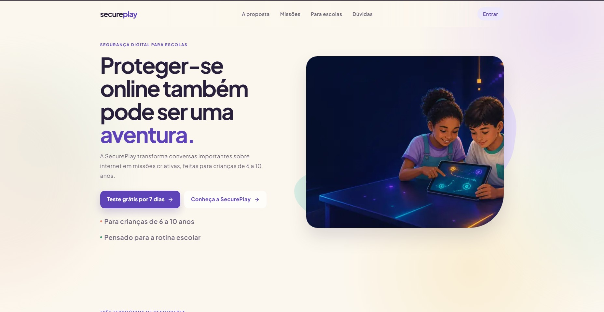
</p>

## O projeto

A SecurePlay transforma temas de segurança digital em uma jornada de descobertas. Missões, leituras, quadrinhos, vídeos e jogos ajudam a trabalhar proteção de informações, convivência online e reconhecimento de situações suspeitas.

O projeto combina desenvolvimento full stack com uma experiência visual própria: academia de missões, mapas em pixel art, progressão por níveis e recompensas. Escolas e organizações podem personalizar a identidade visual e os recursos disponíveis para seus alunos.

Este repositório apresenta o produto e sua implementação técnica como projeto de portfólio. A documentação pública se concentra nas funcionalidades e nas soluções de engenharia; credenciais, dados pessoais e procedimentos dos ambientes operacionais não fazem parte desta apresentação.

## Funcionalidades

| Área | Experiência |
| --- | --- |
| **Jornada do aluno** | Dashboard, mapa de missões, progresso, XP, níveis e sequência de atividades |
| **Aprendizado** | Módulos por dificuldade, aulas em vídeo, quadrinhos e texto, quizzes e desbloqueio progressivo |
| **Prática** | Missões diárias e jogos de perguntas, investigação de mensagens, proteção de informações e descoberta de palavras |
| **Conquistas** | Trilhas de desbloqueio, recompensas e colecionáveis para personalizar o perfil |
| **Ranking** | Classificações por instituição, ranking global quando habilitado e histórico de temporadas |
| **Administração** | Gestão de instituições, usuários, convites, identidade visual e disponibilidade de recursos |
| **Acesso** | Perfis de aluno, administrador da instituição e administrador da plataforma, com fluxos de convite e confirmação de e-mail |
| **Interface** | Navegação responsiva, temas claro/escuro e notificações em tempo real |

### Jogos

- **Quiz Relâmpago:** perguntas rápidas para praticar conhecimentos.
- **Detetives de Mensagens:** investigação de pistas em mensagens suspeitas.
- **Escudos dos Segredos:** classificação e proteção de informações.
- **Palavra Secreta:** descoberta de palavras a partir de tentativas e pistas.

Os três primeiros jogos integram correção e recompensas pela API. Palavra Secreta mantém a partida no navegador. Essa distinção acompanha as necessidades de cada experiência.

## Interface

Capturas das telas atuais, com foco na jornada de aprendizado, nas recompensas e na personalização da plataforma.

<details>
<summary><strong>Acesso à Academia de Missões</strong></summary>

<p>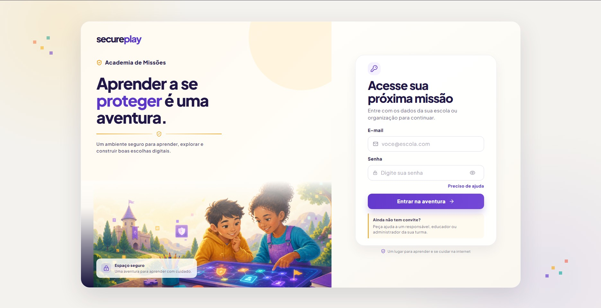</p>
</details>

<details>
<summary><strong>Resumo da aventura e mapa da jornada</strong></summary>

<p>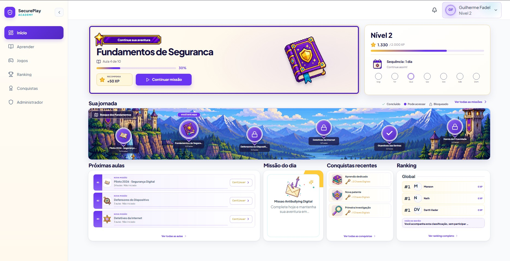</p>
</details>

<details>
<summary><strong>Jogos</strong></summary>

<p>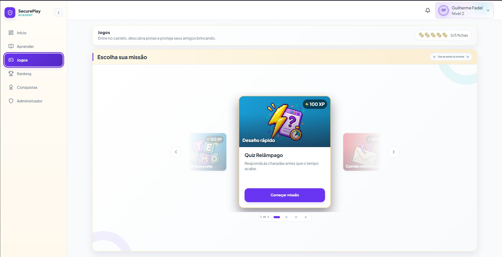</p>
</details>

<details>
<summary><strong>Sala de Missões</strong></summary>

<p>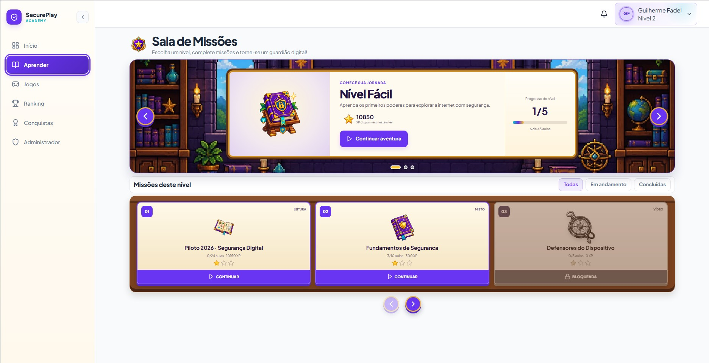</p>
</details>

<details>
<summary><strong>Livro de conteúdos</strong></summary>

<p>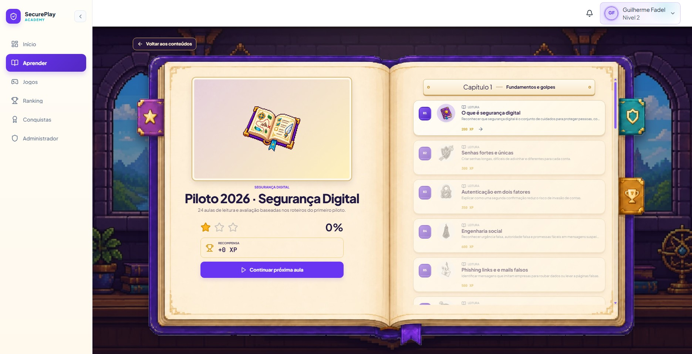</p>
</details>

<details>
<summary><strong>Ambiente de aula</strong></summary>

<p>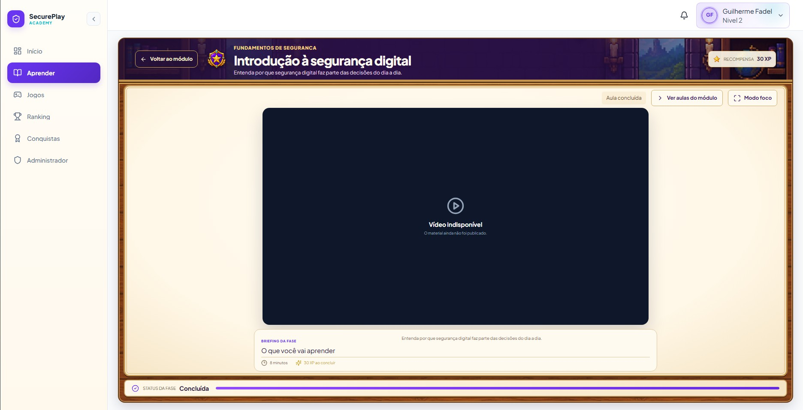</p>
</details>

<details>
<summary><strong>Trilhas de conquistas</strong></summary>

<p>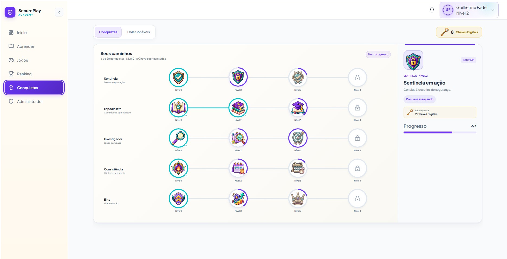</p>
</details>

<details>
<summary><strong>Colecionáveis e personalização do perfil</strong></summary>

<p>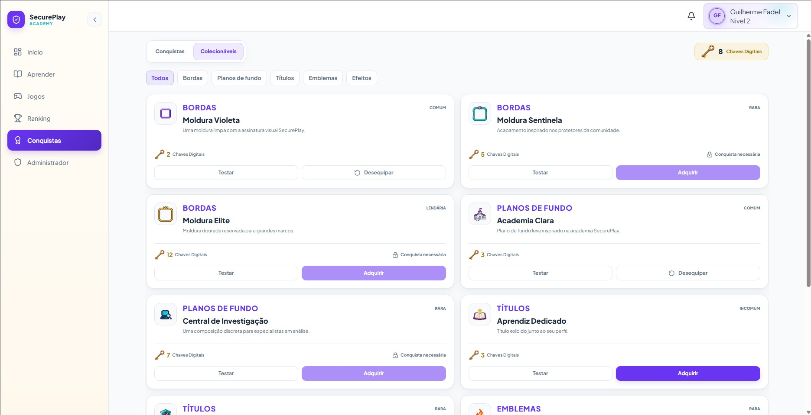</p>
</details>

<details>
<summary><strong>Personalização visual da instituição</strong></summary>

<p>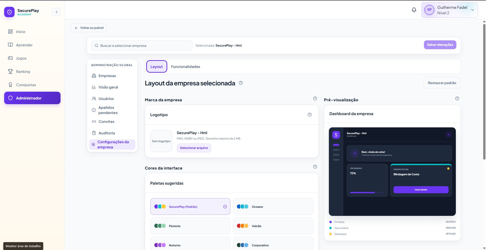</p>
</details>

## Arquitetura e tecnologias

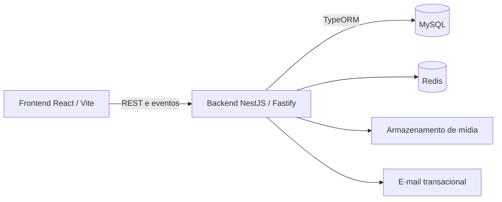

| Camada | Tecnologias |
| --- | --- |
| **Frontend** | React 18, TypeScript 5, Vite 6, Tailwind CSS 4, React Router 7, Axios e Motion/Framer Motion |
| **Backend** | NestJS 11, Fastify, TypeORM, MySQL2, JWT e class-validator |
| **Dados e estado temporário** | MySQL e Redis/Valkey |
| **Integrações** | Socket.IO, armazenamento compatível com S3 e e-mail transacional |
| **Qualidade** | TypeScript, ESLint, Jest e verificações específicas com Node.js |

### Soluções de engenharia

- **Separação de responsabilidades:** frontend organizado em componentes, hooks, contexts e services; backend dividido em módulos de domínio, com DTOs, serviços e persistência.
- **Escopo por instituição:** permissões e recursos disponíveis são verificados no backend. A interface acompanha esses parâmetros para apresentar a experiência adequada a cada perfil.
- **Progressão consistente:** o servidor valida os resultados das atividades e calcula as recompensas nos fluxos integrados à API, mantendo o progresso persistido.
- **Histórico de ranking:** temporadas encerradas preservam a classificação registrada no fechamento. A interface distingue histórico completo de dados indisponíveis.
- **Conteúdo extensível:** uma mesma jornada admite vídeo, quadrinhos e texto, com quizzes associados e acompanhamento de conclusão.
- **Interface reutilizável:** componentes compartilhados e tokens de tema dão consistência às áreas de aprendizado e administração, preservando suas diferenças funcionais.
- **Testes por comportamento:** testes unitários no backend e verificações específicas para o proxy de API, parâmetros de instituições e dicionário do jogo de palavras.

## Organização do código

```text
SecurePlay/
├── frontend/
│   ├── src/           # Interface, estado e integração com a API
│   ├── public/        # Recursos públicos da aplicação
│   ├── functions/     # Proxy de API
│   └── scripts/       # Verificações específicas do frontend
├── backend/
│   ├── src/           # Domínios, regras de negócio e persistência
│   └── test/          # Estrutura de testes E2E
└── assets/readme/      # Imagens da apresentação pública
```

Para explorar a implementação: [frontend](frontend/src/), [backend](backend/src/), [testes de ranking](backend/src/dashboard/) e [testes e lógica de jogos](backend/src/arcade/).

## Validação técnica

Os comandos abaixo permitem avaliar o código em um ambiente de desenvolvimento preparado com dependências próprias. Não exigem acesso aos ambientes operacionais do projeto.

```bash
# Frontend: assets, tipos e build
npm --prefix frontend run build

# Verificações de integração e regras do frontend
npm --prefix frontend run test:api-proxy
npm --prefix frontend run test:company-parameters
npm --prefix frontend run test:termotech-dictionary

# Backend: build e testes unitários
npm --prefix backend run build
npm --prefix backend test -- --runInBand
```

Esses são comandos disponíveis no repositório, não uma declaração de execução ou cobertura integral. Testes E2E e fluxos completos precisam de um ambiente isolado com as dependências apropriadas.

## Estado do projeto

**Em desenvolvimento.** A implementação reúne a jornada de aprendizado, jogos, conquistas, rankings e administração. O catálogo pedagógico e as experiências continuam em evolução; o suporte técnico a um formato de aula não significa que todo o conteúdo planejado já esteja produzido.

O código e as imagens permitem conhecer o trabalho sem acesso a contas reais. Não há credenciais de demonstração nem endereços dos ambientes operacionais nesta apresentação.
